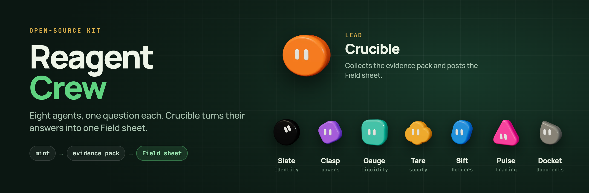

<div align="center">


# Reagent Crew

### An open-source kit to recreate the eight-bot Solana research desk

Drop a mint and get back **one Field sheet** built from evidence, with no guessed grades.

<br/>

[](https://www.reagents.tech/)
[](https://x.com/reagent_rwa)
[](https://github.com/monokernn/REAGENT)

[](LICENSE)
[](https://solana.com)
[](#the-crew)
[](crew/agents)
[](crew/room/field-sheet.md)

<br/>

**[reagents.tech](https://www.reagents.tech/)** · **[@reagent_rwa](https://x.com/reagent_rwa)** · **[assayer CLI](https://github.com/monokernn/REAGENT)**

</div>

---

## What this is

**REAGENT** is a Solana research desk. Instead of one chatbot guessing, it runs as a **crew of eight agents**. Each specialist answers **one question**, and a lead named **Crucible** combines their answers into a single **Field sheet**.

This repo is the **Crew layer**: paste-ready agent prompts, the room protocol, the Field sheet template, and a real worked example. With these files you can rebuild the same desk in **Grok Bot** or **Cursor** in about 15 minutes.

> [!NOTE]
> In production, evidence comes from the REAGENT chain reader, **[assayer](https://github.com/monokernn/REAGENT)** (CLI + MCP). This kit ships the **prompts, protocol, and templates**, so you get the same desk behavior even if you wire up your own collectors. Match the shape in [`pack-sample.json`](crew/examples/pack-sample.json) and you're set.

```
  Assay <mint>  -->  ONE evidence pack  -->  Crucible posts the Field sheet  -->  6 crew notes
                     (scripts, not LLMs)     (immediately, fail-closed)           (one each, same mint)
```

---

## The crew

| Agent | Beat | The one question it answers |
|:--|:--|:--|
| **[Crucible](crew/agents/crucible.md)** · *lead* | The whole picture | Collects the pack and posts the Field sheet |
| **[Slate](crew/agents/slate.md)** | Identity & origin | Is this a real deployed token on this chain, and what does it call itself? |
| **[Clasp](crew/agents/clasp.md)** | Contract powers | What does the token still permit somebody to do to your balance? |
| **[Gauge](crew/agents/gauge.md)** | Liquidity & exits | How deep is the exit, and where? |
| **[Tare](crew/agents/tare.md)** | Supply & burn | Where did supply go, and what is unreachable? |
| **[Sift](crew/agents/sift.md)** | Holders & control | How concentrated is ordinary holder control? |
| **[Pulse](crew/agents/pulse.md)** | Trading activity | What is actually trading, and in which named pool? |
| **[Docket](crew/agents/docket.md)** | Documents & RWA | What do the docs and RWA claims actually say, tied to evidence? |

Specialists **never fetch chain data, never talk to each other, and never invent facts**. A gap counts as a result.

---

## Quick start

```bash
git clone https://github.com/<you>/Reagent-Crew.git
cd Reagent-Crew
```

1. **Create a sidebar section** in Grok Bot named `REAGENT`.
2. **Spawn eight bots.** For each file in [`crew/agents/`](crew/agents), create a new Grok Bot with that name and paste the *Paste as agent description* block.
3. **Open a Crew room** named `REAGENT Crew` with Crucible, Slate, Clasp, Gauge, Tare, and Pulse (rooms cap at 6). Sift and Docket work 1:1.
4. **Give Crucible evidence**, either through [assayer](https://github.com/monokernn/REAGENT) or your own collector that outputs the [pack shape](crew/examples/pack-sample.json).
5. **Say it:**

```text
Assay Dz9mQ9NzkBcCsuGPFJ3r1bS4wgqKMHBPiVuniW8Mbonk
```

Crucible posts the Field sheet right away, and the crew adds one note each. The full checklist with troubleshooting is in [`scripts/spawn-checklist.md`](scripts/spawn-checklist.md).

---

## Field sheet

Every Assay ends in **one markdown sheet**: a headline, the main catch, a letter grade from real risk points, risk bands with unicode bars, and six crew lines.

<details>
<summary><b>Preview: $USELESS, Entry risk B (18 / 100)</b></summary>

<br/>

| Band | Points | Reading |
| --- | --- | --- |
| Token powers | `░░░░░░░░░░` 0 / 36 | No power over somebody else's balance was found |
| Holder concentration | `███████░░░` 18 / 26 | Top sample holders hold 36.48% |
| Liquidity & exit room | `░░░░░░░░░░` 0 / 20 | Deepest pool returned holds $4,202,446 |
| Provider-reported checks | `░░░░░░░░░░` 0 / 18 | RugCheck raised none of its checks |

**Main catch:** The top ordinary holders in the sample control 36.48% of supply, and one wallet alone holds 8.96%.

→ [Full example sheet](crew/examples/field-sheet-example.md)

</details>

- Template: [`crew/room/field-sheet.md`](crew/room/field-sheet.md)
- Real example: [`crew/examples/field-sheet-example.md`](crew/examples/field-sheet-example.md)
- Evidence behind it: [`crew/examples/pack-sample.json`](crew/examples/pack-sample.json)

---

## Protocol

The rules every agent follows ([full doc](crew/room/protocol.md)):

- **One shared pack.** Evidence is collected **once per mint** by scripts, and agents only read it.
- **Fail-closed lead.** Crucible posts the sheet **immediately** and never waits for notes. It writes any missing or wrong-mint line itself.
- **One note each.** Each specialist posts 1–2 English sentences, labeled with its beat, for the current mint only.
- **Never mix mints.** One sheet covers one mint.
- **Never invent a grade.** A band without evidence is withheld with a reason.
- **English only.** No wallet, signature, or transaction, and no bubble maps.
- **Sift may sit out.** When the room is full, Crucible writes the Sift line from the holders sample and labels it.

---

## Folder map

```
Reagent-Crew/
├── README.md
├── LICENSE
├── crew/
│   ├── agents/              # paste-ready agent descriptions
│   │   ├── crucible.md      #   lead + full Field sheet template
│   │   ├── slate.md  clasp.md  gauge.md  tare.md
│   │   ├── sift.md   pulse.md  docket.md
│   ├── room/
│   │   ├── protocol.md      # how an Assay runs
│   │   └── field-sheet.md   # the exact sheet template
│   └── examples/
│       ├── field-sheet-example.md   # real $USELESS sheet
│       └── pack-sample.json         # sanitized evidence pack
└── scripts/
    └── spawn-checklist.md   # rebuild the desk step by step
```

---

## Related

| | |
|:--|:--|
| **Website** | [reagents.tech](https://www.reagents.tech/) — live Field sheets |
| **Updates** | [@reagent_rwa](https://x.com/reagent_rwa) |
| **Chain reader** | [monokernn/REAGENT](https://github.com/monokernn/REAGENT) — `assayer` CLI + MCP that collects and rates the evidence pack |
| **Built by** | [@monokern](https://x.com/monokern) |

**This repo is the Crew. assayer is the chain reader.** Use both to run the full desk.

---

## License

[MIT](LICENSE) © 2026 monokern / REAGENT

<div align="center">
<br/>
<sub>Research, not financial advice. The desk reads data and never connects a wallet, signs, or sends a transaction.</sub>
<br/><br/>
<a href="https://www.reagents.tech/">reagents.tech</a> · <a href="https://x.com/reagent_rwa">@reagent_rwa</a>
</div>
